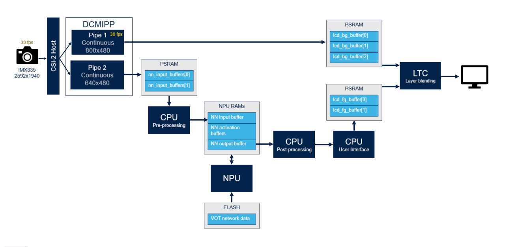
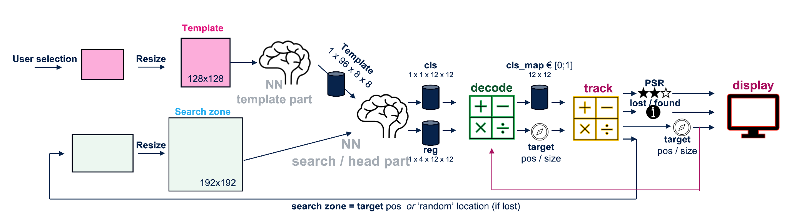
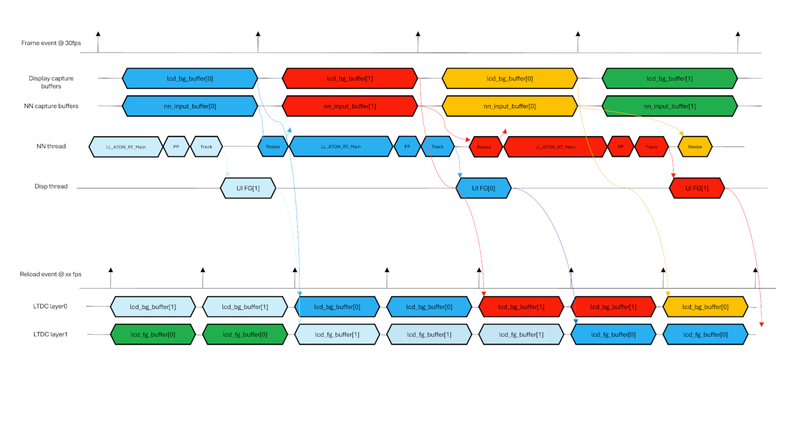
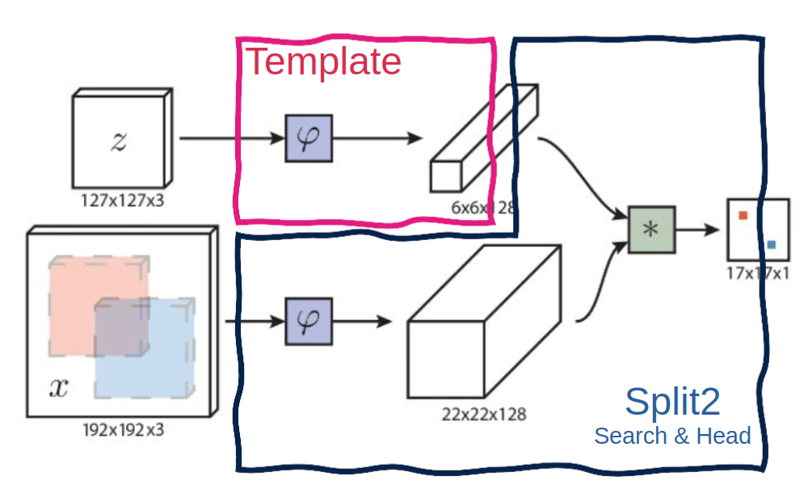
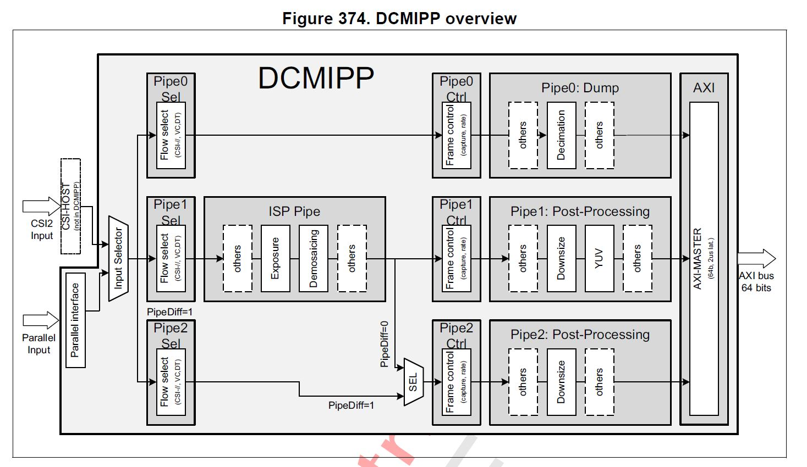

# Application Overview

## What Is Visual Object Tracking?

Visual Object Tracking (VOT) is the task of following a selected object in a live camera stream over time.
Starting from an initial target region, the tracker estimates the object's position and size in each new frame.
Unlike object detection, tracking does not search for all object categories in each frame.
Instead, it maintains the identity of a single target selected by the user.
The tracker handles motion, scale changes, blur, partial occlusion, and illumination variations.
It outputs a bounding box and a confidence score indicating tracking reliability.
When confidence drops, recovery logic can expand the search area or declare the target as lost.
VOT is widely used in robotics, surveillance, human-machine interaction, and edge AI cameras.

## Application Behavior

### Object Selection

When the application starts, the live camera feed is displayed on the screen. The user must **tap the touchscreen** to select the object to track: the application captures the tapped region as the initial template and immediately starts the tracking session.

At any point during tracking, the user can **tap again** to select a new object, which restarts the tracking session on the new target.

### Tracking and Loss Handling

At each frame, the tracker assesses its confidence based on several criteria including the Peak-to-Sidelobe Ratio (PSR) score: the bounding box is displayed in green when tracking is reliable, in orange when confidence is low, and the target is marked as **LOST** when tracking has failed.

When the target is lost, the tracker searches only **around the last known position** to recover. This approach is well-suited to temporary occlusion scenarios where the object is expected to reappear nearby.

## Application Data Flow

### Processing Chain

The following diagram summarizes the main stages of the tracking pipeline: user selection, resize, two-network inference, decode, tracker update, and display.

## Application Timing Diagram

## Neural Network Model

The tracking model implemented in this application is **LightTrackM**. To optimize memory usage and execution on the STM32N6 NPU, the model is split into two independent sub-models:

### Template Sub-model (`vot_template`)

The template sub-model is executed **once**, when the user selects the object to track. It processes a crop of the initial frame centered on the selected object, which is rescaled to an input resolution of **127×127** pixels, and produces a feature embedding that serves as the reference descriptor for the entire tracking session.

### Tracking Sub-model (`vot_split2`)

The tracking sub-model is executed **on every frame**. It takes the template embedding produced by the template sub-model together with a search-region crop from the current frame, which is rescaled to an input resolution of **192×192** pixels, and estimates the position and scale of the tracked object within that frame.

This split avoids re-computing the expensive template extraction at every frame, keeping per-frame inference lightweight.

## Memory Footprint Details

### Read-Only Data

| Name                | Size     | Location | Notes            |
|---------------------|----------|----------|------------------|
| `vot_split2_data`   | 1.2 MB   | .rodata  | FLASH xSPI2 8b   |
| `vot_template_data` | 1.9 MB   | .rodata  | FLASH xSPI2 8b   |

### Read-Write Data

| Name                    | Size     | Location   | Notes                                         |
|-------------------------|----------|------------|-----------------------------------------------|
| `lcd_bg_buffer`         | 2250 KB  | .psram_bss | PSRAM / (800x480x2) x 3 / RGB565              |
| `lcd_fg_buffer`         | 1500 KB  | .psram_bss | PSRAM / (800x480x2) x 2 / ARGB4444            |
| `nn_input_buffers`      | 1800 KB  | .psram_bss | PSRAM / (640x480x3) x 2 / RGB888              |
| `activations(split2)`   | 1356 KB  | 0x34200000 | NPURAMS.                                      |
| `activations(template)` |  600 KB  | 0x34200000 | NPURAMS. Memory reused for split2 activations |

## DCMIPP and ISP

### DCMIPP Overview

- Pipe 1 is enabled using `CMW_CAMERA_Start(DCMIPP_PIPE1, *ptr_dst, CAMERA_MODE_CONTINUOUS);` to continuously transmit images from imx335 to the DISPLAY_BUFFER_NB buffered `lcd_bg_buffer[]`. Note that `ptr_dst` will be updated at pipe1 frame_event.
- Pipe 2 is enabled using `CMW_CAMERA_Start(DCMIPP_PIPE2, *ptr_dst, CAMERA_MODE_CONTINUOUS);` to continuously transmit images from imx335 to the double buffered `nn_input_buffers[]`. Note that `ptr_dst` will be updated at pipe2 frame_event. This allows dropping the previous frame if the buffer is still in use by the nn thread.
- For each capture, the ISP configuration is updated to enhance the image quality depending on the illumination conditions. It is initialized through `ISP_Init` and then executed with `ISP_BackgroundProcess`.

For more details on DCMIPP, see the Digital Camera Interface Pixel Pipeline (DCMIPP) section in the STM32N6 Reference Manual.