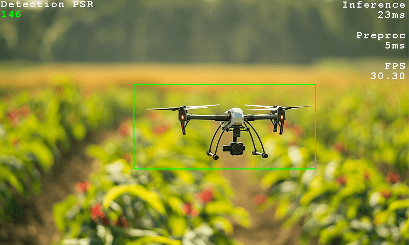
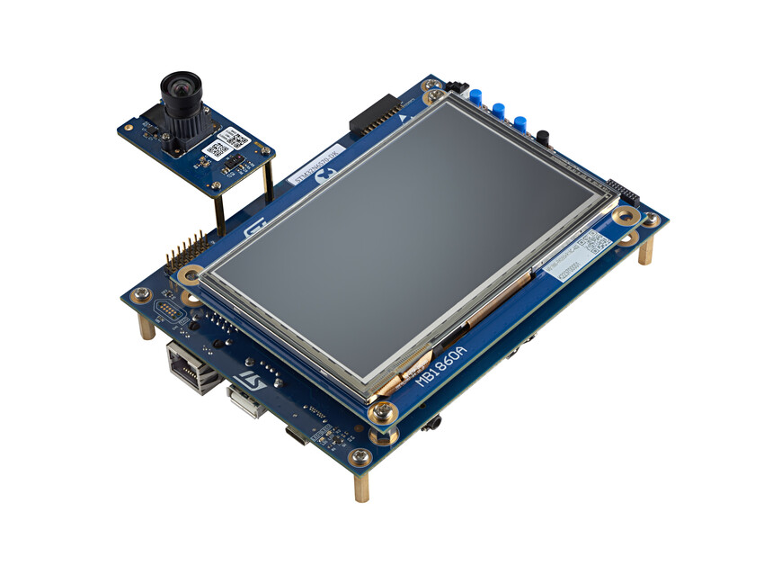
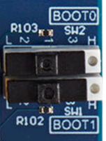
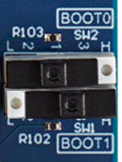

# x-cube-n6-ai-visual-object-tracking Application

Computer Vision application demonstrating the deployment of a Visual Object Tracking (VOT) model on the STM32N6570-DK board.

This application is prebuilt with the LightTrackM VOT model for STM32N6570-DK.

This top readme gives an overview of the app. Additional documentation is available in the [Doc](./Doc/) folder.



---

## Table of Contents

- [Features Demonstrated in This Example](#features-demonstrated-in-this-example)
- [Model](#model)
- [Hardware Support](#hardware-support)
- [Tools Version](#tools-version)
- [Boot Modes](#boot-modes)
- [Console parameters](#console-parameters)
- [Quickstart Using Prebuilt Binaries](#quickstart-using-prebuilt-binaries)
  - [Flash Prebuilt Binaries](#flash-prebuilt-binaries)
  - [How to Program Hex Files Using STM32CubeProgrammer UI](#how-to-program-hex-files-using-stm32cubeprogrammer-ui)
  - [How to Program Hex Files Using Command Line](#how-to-program-hex-files-using-command-line)
- [Quickstart Using Source Code](#quickstart-using-source-code)
  - [Application Build and Run - Dev Mode](#application-build-and-run---dev-mode)
  - [Application Build and Run - Boot from Flash](#application-build-and-run---boot-from-flash)
- [How to update my project with a new version of ST Edge AI](#how-to-update-my-project-with-a-new-version-of-st-edge-ai)

**Documentation Folder Content:**

- [Application Overview](Doc/Application-Overview.md)
- [Boot Overview](Doc/Boot-Overview.md)
- [Build Options](Doc/Build-Options.md)
- [Program Hex Files Using STM32CubeProgrammer](Doc/Program-Hex-Files-STM32CubeProgrammer.md)

---

## Features Demonstrated in This Example

- Multi-threaded application flow (FreeRTOS)
- Single-object tracking with basic re-identification support
- Touchscreen target selection
- NPU accelerated quantized AI model inference
- Dual DCMIPP pipes with downscale
- LTDC dual-layer implementation
- DCMIPP ISP usage
- Dev mode
- Boot from External Flash

---

## Model

| Model | Board | Inference time |
| :---- | :---- | -------------: |
| lighttrackm_split2_192_n6_int8.onnx<br>lighttrackm_template_127_n6_int8.onnx | STM32N6570-DK | 23 ms |

---

## Hardware Support

Supported development platforms:

- [MB1939 STM32N6570-DK](https://www.st.com/en/evaluation-tools/stm32n6570-dk.html) Discovery Board
  - Connect to the onboard ST-LINK debug adapter (CN6) using a __USB-C to USB-C cable__ for sufficient power.
  - OTP fuses are configured for xSPI IOs to achieve maximum speed (200MHz) on xSPI interfaces.


STM32N6570-DK board with MB1854B IMX335.

Supported camera modules:
- MB1854B IMX335 (Default Camera provided with the MB1939 STM32N6570-DK board)
- [STEVAL-55G1MBI](https://www.st.com/en/evaluation-tools/steval-55g1mbi.html) VD55G1 Camera module (Use the CSI-2 cable provided with the camera module)
- [STEVAL-66GYMAI1](https://www.st.com/en/evaluation-tools/steval-66gymai.html) VD66GY Camera module (Use the CSI-2 cable provided with the camera module)
- STEVAL-1943-MC1 VD1943 Camera module (Use the CSI-2 cable provided with the camera module)

---

## Tools Version

- IAR Embedded Workbench for Arm (__EWARM 9.40.1__) + N6 patch ([__EWARMv9_STM32N6xx_V1.0.0__](STM32Cube_FW_N6/Utilities/PC_Software/EWARMv9_STM32N6xx_V1.0.0.zip))
- [STM32CubeIDE](https://www.st.com/content/st_com/en/products/development-tools/software-development-tools/stm32-software-development-tools/stm32-ides/stm32cubeide.html) (__v2.1.1__)
- [STM32CubeProgrammer](https://www.st.com/en/development-tools/stm32cubeprog.html) (__v2.22.0__)
- [STEdgeAI](https://www.st.com/en/development-tools/stedgeai-core.html) (__v4.0.1__)

---

## Boot Modes

The STM32N6 series does not have internal flash memory. To retain firmware after a reboot, program it into the external flash. Alternatively, you can load firmware directly into SRAM (development mode), but note that the program will be lost if the board is powered off in this mode.

Development Mode: used for loading firmware into RAM during a debug session or for programming firmware into external flash.

Boot from Flash: used to boot firmware from external flash.

|                  |                                                                              |
| -------------    | -------------                                                                |
| Boot from flash  |  |
| Development mode |        |

---

## Console parameters

You can see application messages by attaching a console application to the ST-Link console output. Use the following console parameters:
- Baud rate of 115200 bps.
- No parity.
- One stop bit.

---

## Quickstart Using Prebuilt Binaries

### Flash Prebuilt Binaries

  1. Set the board to [development mode](#boot-modes).
  2. Program `Binary/STM32N6570-DK/x-cube-n6-ai-visual-object-tracking-dk.hex`.
  3. Set the board to [boot from flash mode](#boot-modes).
  4. Power cycle the board.
  5. The application will start, and you will be prompted to select an object to track on the touchscreen.

---

### How to Program Hex Files Using STM32CubeProgrammer UI

See [How to Program Hex Files STM32CubeProgrammer](Doc/Program-Hex-Files-STM32CubeProgrammer.md).

---

### How to Program Hex Files Using Command Line

Make sure to have the STM32CubeProgrammer bin folder added to your path.

```bash
export DKEL="<STM32CubeProgrammer_N6 Install Folder>/bin/ExternalLoader/MX66UW1G45G_STM32N6570-DK.stldr"

STM32_Programmer_CLI -c port=SWD mode=HOTPLUG -el $DKEL -hardRst -w Binary/STM32N6570-DK/x-cube-n6-ai-visual-object-tracking-dk.hex
```

---

## Quickstart Using Source Code

Before building and running the application, you have to program `vot_template_data.hex` and `vot_split2_data.hex` (model weights and biases).

This step only has to be done once unless you change the AI model.
See [Quickstart Using Prebuilt Binaries](#quickstart-using-prebuilt-binaries) for details.

More information about boot modes is available at [Boot Overview](Doc/Boot-Overview.md).

### Application Build and Run - Dev Mode

Set your board to [development mode](#boot-modes).

#### STM32CubeIDE

Double click on `STM32CubeIDE/STM32N6570-DK/.project` to open the project in STM32CubeIDE. Build and run with the build and run buttons.

#### IAR EWARM

Double click on `EWARM/STM32N6570-DK/x-cube-n6-ai-visual-object-tracking-dk.eww` to open the project in IAR IDE. Build and run with the build and run buttons.

#### Makefile

Before running the commands below, be sure to have the commands in your PATH.

1. Build the project using the provided `Makefile`:

```bash
make -j8
```

2. Open a GDB server connected to the STM32 target:

```bash
ST-LINK_gdbserver -p 61234 -l 1 -d -s -cp <path-to-stm32cubeprogrammer-bin-dir> -m 1 -g
```

3. In a separate terminal session, launch a GDB session to load the firmware image into the device memory:

```bash
$ arm-none-eabi-gdb build/Project.elf
(gdb) target remote :61234
(gdb) monitor reset
(gdb) load
(gdb) continue
```

---

### Application Build and Run - Boot from Flash

Set your board to [development mode](#boot-modes).

#### STM32CubeIDE

Double click on `STM32CubeIDE/STM32N6570-DK/.project` to open project in STM32CubeIDE. Build with build button.

#### IAR EWARM

Double click on `EWARM/STM32N6570-DK/x-cube-n6-ai-visual-object-tracking-dk.eww` to open project in IAR IDE. Build with build button.

#### Makefile

Before running the commands below, be sure to have them in your PATH.

1. Build project using the provided `Makefile`:

```bash
make -j8
```

Once your app is built with Makefile, STM32CubeIDE, or EWARM, you must add a signature to the bin file:
```bash
STM32_SigningTool_CLI -bin build/Project.bin -align -nk -t ssbl -hv 2.3 -o build/Project_sign.bin
```

You can program the FSBL, the signed bin file at the address 0x70100000 and the network parameters:

```bash
export DKEL="<STM32CubeProgrammer_N6 Install Folder>/bin/ExternalLoader/MX66UW1G45G_STM32N6570-DK.stldr"

# First Stage Boot Loader
STM32_Programmer_CLI -c port=SWD mode=HOTPLUG -el $DKEL -hardRst -w FSBL/ai_fsbl.hex

# Network Parameters and Biases
STM32_Programmer_CLI -c port=SWD mode=HOTPLUG -el $DKEL -hardRst -w Model/vot_template_data.hex
STM32_Programmer_CLI -c port=SWD mode=HOTPLUG -el $DKEL -hardRst -w Model/vot_split2_data.hex

# Adapt build path to your IDE
STM32_Programmer_CLI -c port=SWD mode=HOTPLUG -el $DKEL -hardRst -w build/Project_sign.bin 0x70100000
```

__Note__: Only the application binary needs to be programmed if `fsbl` and networks data have already been programmed.

Set your board to [boot from flash](#boot-modes) mode and power cycle to boot from external flash.

---

## How to update my project with a new version of ST Edge AI

The neural network model files (`(stai_)vot_{template,split2}.c/h`) included in this project were generated using [STEdgeAI](https://www.st.com/en/development-tools/stedgeai-core.html) version 4.0.1.

Using a different version of STEdgeAI to generate these model files may result in the following compile-time error:
`Possible mismatch in ll_aton library used`.

If you encounter this error, please follow the STEdgeAI instructions on [How to update my project with a new version of ST Edge AI Core](https://stedgeai-dc.st.com/assets/embedded-docs/stneuralart_faqs_update_version.html) to update your project.
